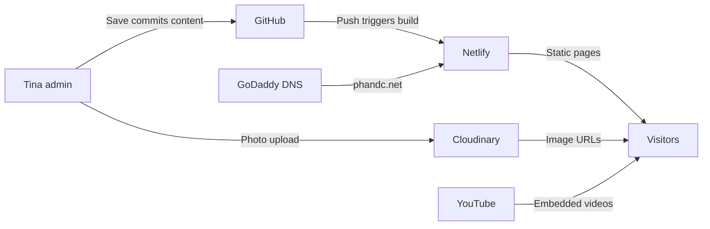
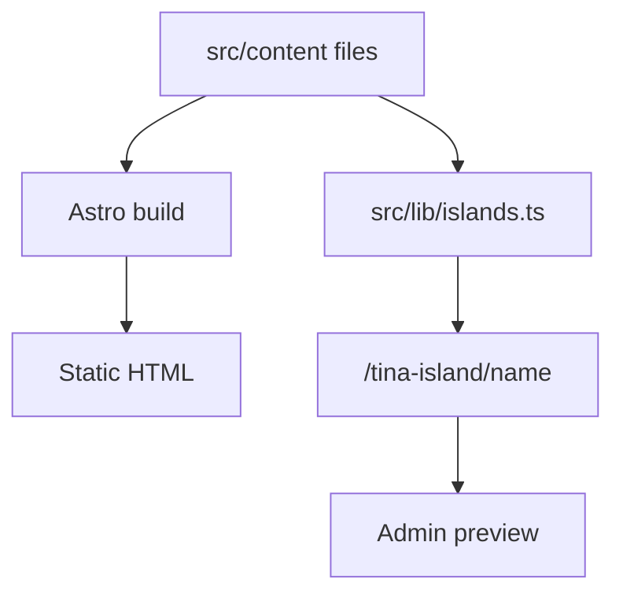
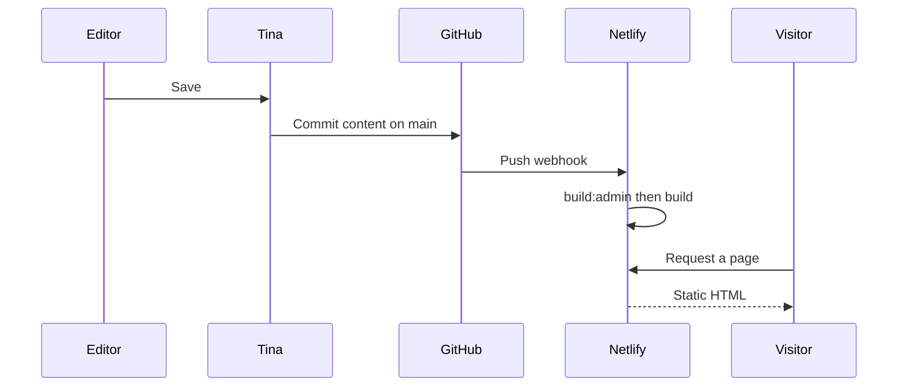

# Architecture

phandc.net is a static site. Editors change pages in Tina. Tina commits those changes to GitHub. Netlify rebuilds the site from that commit and serves it. Photos live in Cloudinary. The domain is registered at GoDaddy and pointed at Netlify.

The repository is [hunt3r/phc](https://github.com/hunt3r/phc). Production builds the `main` branch unless `GITHUB_BRANCH`, `VERCEL_GIT_COMMIT_REF`, or `HEAD` is set; see the branch selection in [tina/config.ts](tina/config.ts).

## Accounts and where each one is configured

| Service | What it holds | Where it is configured |
| --- | --- | --- |
| GitHub | The site files, including content. Tina commits here on Save. | Repository [hunt3r/phc](https://github.com/hunt3r/phc). |
| Tina Cloud | Editor login, the GitHub connection, and the admin at `/admin`. | Tina project. Client id and token are `NEXT_PUBLIC_TINA_CLIENT_ID` and `TINA_TOKEN`. |
| Netlify | Hosting, the production build, the two on-demand functions, and the contact form. | Site connected to the GitHub repo. Build command is in [netlify.toml](netlify.toml). The same Cloudinary and Tina env vars are set in the Netlify dashboard. |
| Cloudinary | Uploaded photos. | `CLOUDINARY_CLOUD_NAME`, `CLOUDINARY_API_KEY`, `CLOUDINARY_API_SECRET`. |
| GoDaddy | The phandc.net domain and the DNS that points it at Netlify. | The GoDaddy account. Record values are not in this repo. |

Pricing pages, which change independently of this doc: [GitHub](https://github.com/pricing), [Tina](https://tina.io/pricing), [Netlify](https://www.netlify.com/pricing/), [Cloudinary](https://cloudinary.com/pricing), [GoDaddy domains](https://www.godaddy.com/domains). DNS for the domain is part of the domain registration.

Local names for those env vars are listed in [.env.example](.env.example). `TINA_SEARCH_ENABLED=true` turns on Tina Cloud search; leave it unset unless a dedicated search token is configured, because a bad indexer token stalls schema indexing.

## Runtime

[astro.config.mjs](astro.config.mjs) sets `output: 'static'`, `site: 'https://www.phandc.net'`, `trailingSlash: 'ignore'`, the Netlify adapter, the Tina integration, and `@astrojs/sitemap`. Tailwind 4 is a Vite plugin and styles the pages. It has no content or deploy role.

[netlify.toml](netlify.toml) runs `npm run build:admin && npm run build`. The adapter publishes the static files and turns each `prerender = false` route into a Netlify Function. Two routes opt out of prerender:

- [src/pages/tina-island/[name].ts](src/pages/tina-island/[name].ts) refreshes the visual editor.
- [src/pages/api/cloudinary/[...media].ts](src/pages/api/cloudinary/[...media].ts) uploads, lists, and deletes media.

Everything else, including `/llms.txt` and `/llms-full.txt`, is generated at build time.

## Content and routes

Public content is markdown and JSON under `src/content/`, loaded by the Astro collections in [src/content.config.ts](src/content.config.ts). The Tina schema for the same files is in [tina/config.ts](tina/config.ts). A field visitors see has to exist in both, render on the public page, and render again in the matching Tina island.

The **How to use this site** articles in `src/content/guides/` are a Tina collection only. They are not registered in `src/content.config.ts`, they have no router, and create and delete are turned off. They never become public pages.

| Tina collection | Files | Public URL |
| --- | --- | --- |
| Home | `src/content/home` | `/` |
| Portfolio | `src/content/portfolio` | `/portfolio/<slug>` |
| Tags | `src/content/tags` | Hub or leaf URL from the tag's root. See below. |
| About Us | `src/content/about` | `/about` |
| Staff | `src/content/staff` | People listed on `/about`. Each person is `/about/<slug>`, with the slug derived in [src/data/staff.ts](src/data/staff.ts). |
| Contact | `src/content/contact` | `/contact` |
| Pages | `src/content/pages` | `/<slug>` via [src/pages/[slug].astro](src/pages/[slug].astro) |
| Site Settings | `src/content/site` | Header links, footer links, and the footer description. No page of its own. |
| How to use this site | `src/content/guides` | Admin only. |

Other public routes are assembled from those collections:

- `/portfolio` is the portfolio hub. It reads the `portfolio` root tag for its title.
- `/portfolio/[slug]` is either a project or a sector tag. [src/pages/portfolio/[slug].astro](src/pages/portfolio/[slug].astro) emits both: a tag whose root ancestor is `portfolio` renders [PortfolioCategoryPage.astro](src/components/PortfolioCategoryPage.astro); a portfolio entry renders [PortfolioProjectPage.astro](src/components/PortfolioProjectPage.astro).
- `/services` and `/services/[slug]` are the services hub and each service tag.
- `/videos` flattens inline videos from portfolio, tags, about, pages, and contact ([src/lib/videos.ts](src/lib/videos.ts)).
- `/testimonials` flattens quotes stored on portfolio entries ([src/lib/quotes.ts](src/lib/quotes.ts)).
- `/contact/success` is the Netlify Forms thank-you page.

[src/lib/tags.ts](src/lib/tags.ts) decides a tag URL from `ROOT_ROUTES`:

- `portfolio` hub `/portfolio`, leaves `/portfolio/<slug>`
- `services` hub `/services`, leaves `/services/<slug>`

A root that is not in that map would be linked as `/tags/<slug>`. There is no Astro page for that prefix today, so a new top-level tag type needs a `ROOT_ROUTES` entry and matching hub and `[slug]` pages.

## Two copies of a page

Visitors receive HTML baked at build time from `astro:content`. In the admin, Tina opens that same page in a preview and swaps regions as the editor types.

[src/lib/islands.ts](src/lib/islands.ts) maps an island name to a Tina query, an Astro component, and the props that component needs. The preview bridge POSTs to `/tina-island/<name>` on each keystroke. [experimental_createIslandRoute](src/pages/tina-island/[name].ts) renders the component against the editor's overlay data and returns an HTML fragment.

`tinaField` on the element that shows a value is what focuses the matching form input on click. If the island does not render the field, the preview will not update and the click will not focus the input. Portfolio detail rows go through `ProjectSpecs` so each value stays click-to-edit.

Island names: `portfolio`, `portfolioHero`, `tag`, `tagHero`, `about`, `page`, `contact`, `home`, `staff`, `staffProfile`, plus content-card islands (`tagCards`, `pageCards`, `contactCards`, `aboutCards`, `homeCards`) and `contactInfo`. The project page keeps gallery and content cards inside the `portfolio` island, because a refresh of an outer island replaces nested islands.

**Staff** and **Site Settings** open the form on their own. The other collections open the live page beside the form.

## Save and deploy

Tina Cloud is the process that commits. The admin does not push from the editor's browser. The commit lands on the branch chosen in [tina/config.ts](tina/config.ts), which is `main` in production.

Netlify then runs two npm scripts. `prebuild:admin` is an npm lifecycle hook, so it runs before `build:admin` without being named in [netlify.toml](netlify.toml).

1. `npm run generate:tag-routes` writes [tina/tag-routes.ts](tina/tag-routes.ts). The tags collection router runs in the browser and only receives the clicked document, so it cannot walk the parent chain. The generated map is the slug-to-URL table that router imports.
2. `tinacms build` writes the admin UI to `admin/`.
3. `npm run generate:redirects` writes `public/_redirects` from the old WordPress URL manifest and the current portfolio and tag files.
4. `astro build` renders the static site, the sitemap, and the two text endpoints for AI tools.

A photo does not wait for that pipeline. The admin uploads it through the Cloudinary function immediately. The page that references the new URL still waits for the rebuild.

## Media

Tina's media store is `TinaCloudCloudinaryMediaStore` from `next-tinacms-cloudinary`, loaded in [tina/config.ts](tina/config.ts). The admin talks to `/api/cloudinary/media`.

The handler in [src/pages/api/cloudinary/[...media].ts](src/pages/api/cloudinary/[...media].ts) buffers the request body and passes it to Cloudinary's media handler. Outside local development it calls `isAuthorized` from `@tinacms/auth` and rejects the request when the Tina user is not verified. In development the route allows the upload so `npm run dev` can save photos without a separate API process.

[src/lib/cloudinary.ts](src/lib/cloudinary.ts) rewrites Cloudinary URLs with `f_auto` and `q_auto` transforms for delivery. Local paths and non-Cloudinary URLs pass through unchanged.

## Forms, search, and AI text

The contact form in [src/components/ContactForm.astro](src/components/ContactForm.astro) is a Netlify Form named `contact`. It posts to `/contact/success`, uses Netlify's reCAPTCHA attribute, and includes a honeypot field named `bot-field`. Submissions show up in the Netlify site. Field definitions live in [src/lib/contact-form.ts](src/lib/contact-form.ts).

[BaseLayout.astro](src/layouts/BaseLayout.astro) sets the document title to `PH&C - <page title>`, a canonical URL, and an Open Graph image. The image is the page image run through Cloudinary at 1200 by 630, or `/images/logo-color.png` when the page has none. The layout also emits a JSON-LD graph: organization, website, and web page from [src/lib/seo/jsonld.ts](src/lib/seo/jsonld.ts), plus whatever extra nodes the page passes (breadcrumbs, a person, a creative work, services, FAQ).

The sitemap integration writes `sitemap-index.xml` (and `sitemap-0.xml`) with one canonical URL per public page, without a trailing slash, `lastmod`, `changefreq`, or `priority`. `/contact/success` is omitted. `/sitemap.xml` and `/sitemap_index.xml` redirect to the index.

`/llms.txt` and `/llms-full.txt` are built by [src/lib/llms.ts](src/lib/llms.ts) from the content collections. The short file is a link map. The full file inlines page and project text. Both follow the llms.txt convention: an H1, a one-line summary, then H2 sections of links.

## Day-to-day scripts

These are the scripts that still run as part of operating the site. Each is an npm script in [package.json](package.json).

| Script | When it runs | What it writes |
| --- | --- | --- |
| `generate:tag-routes` | Before every admin build, via `prebuild:admin`. Re-run it after adding or moving tags. | [tina/tag-routes.ts](tina/tag-routes.ts) |
| `generate:redirects` | Every production build, as the first step of `npm run build`. | `public/_redirects`, mapping old WordPress paths onto current URLs. |
| `export:portfolio` | By hand, when project specs need to be filled in outside Tina. | `data/portfolio-data.csv` |
| `import:portfolio` | By hand, after that CSV is filled in. | Portfolio frontmatter. Empty cells are skipped. Body, gallery, image, quotes, order, and tags are left as they are. `slug` is the join key. |
| `sync:cloudinary` | By hand, to upload files from `public/images` and point content at the Cloudinary URLs. `--dry-run` prints the plan and writes nothing. | Cloudinary assets and image URLs inside `src/content`. |

`npm run dev` is `tinacms dev -c "astro dev"`. The admin is at `/admin/index.html`. The Cloudinary and island routes run on the Astro dev server.

The `scripts/` folder also contains the WordPress scrape and the one-time generators and tag migrations that moved the old site into `src/content/`. Those scripts are not part of the running site or the Netlify build.
